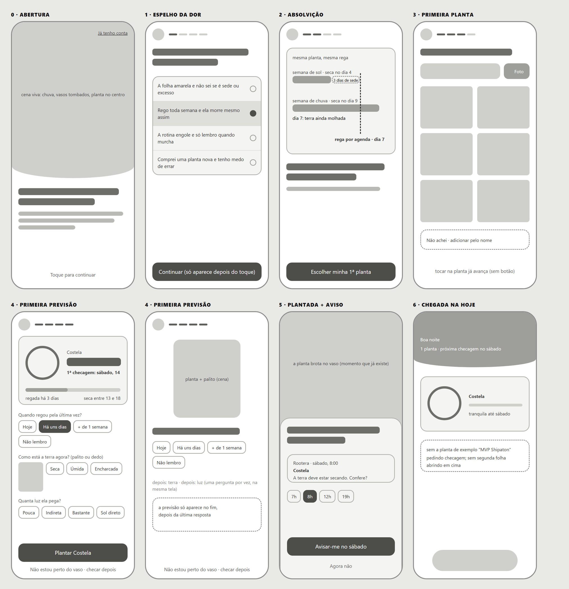
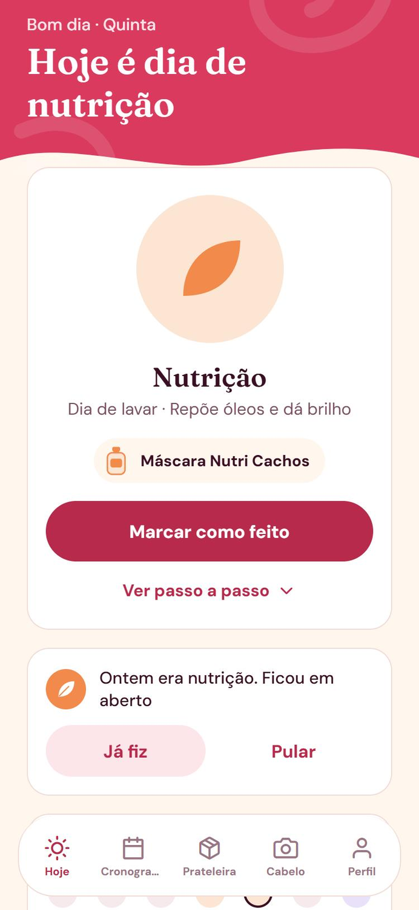
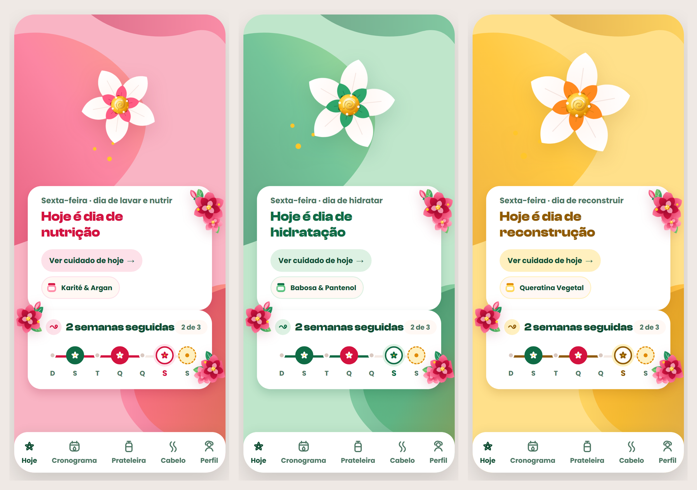
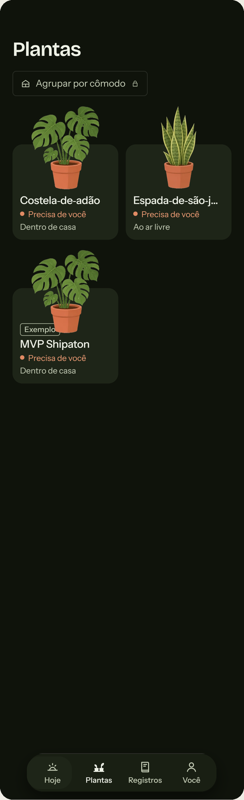
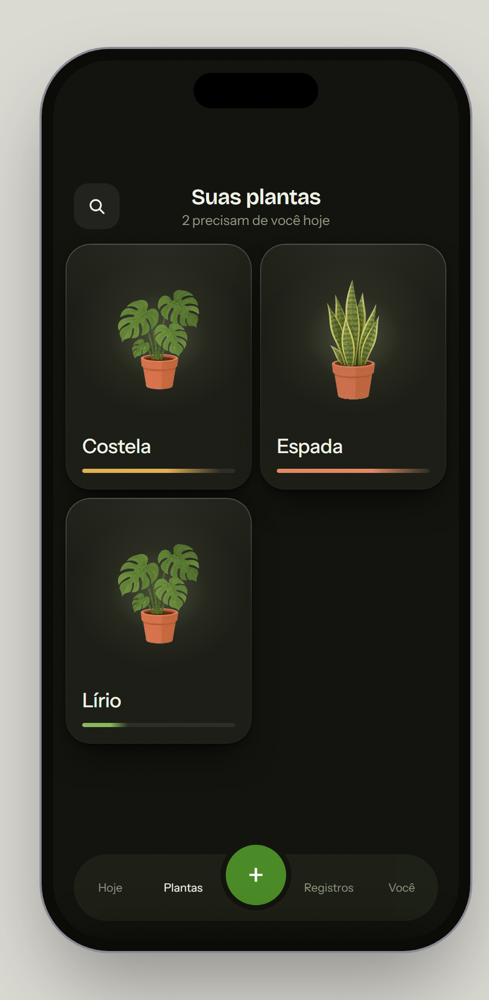
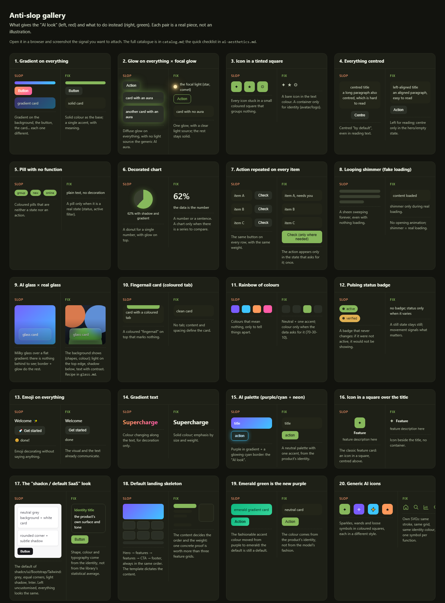

# take the "AI slop" out of an interface

A skill (Claude Code, Codex, OpenCode) that **de-slops an existing screen**, or **builds a new one without the AI-generated look**.

"AI slop" is a screen that looks assembled by someone who doesn't use the product: every block with the same visual weight, text explaining what a drawing would show, repeated actions, gradients/glass/glow used as decoration. The goal is for **every element to exist for a reason the user can feel**.

---

## It starts with a wireframe

Before any colour or font, the skill proposes gray skeletons and asks which organisation to follow. It is the cheapest moment to change your mind. Below, the onboarding of a plant-care app: eight screens decided in gray, including two options for the same step, before spending time on colour, art and animation.



## Before and after

Real screens that went through the skill and were approved by the author. Each case in [`docs/cases/`](docs/cases/) says what was found, what changed and what stayed on purpose.

**Cronohair · Home** ([case](docs/cases/04-cronohair-home/)): the Today screen of the app, then the redesigned Home on the three treatment days (nutrition, hydration, reconstruction).

| Before | After |
|---|---|
|  |  |

**Rootera** ([Plant](docs/cases/01-rootera-plant/) and [Plants](docs/cases/02-rootera-plants/)):

| | Before | After |
|---|---|---|
| **Plant** |  |  |
| **Plants** |  |  |

A screen built from scratch is in [Plants that left](docs/cases/03-rootera-plants-that-left/).

## The signals, one by one

The element gallery shows every pattern the skill flags in isolation, side by side with the fix (slop on the left in red, fix on the right in green):



The same gallery is rendered live in [`skills/deslop/reference/gallery.html`](skills/deslop/reference/gallery.html). One image per rule is in [`docs/pares/`](docs/pares/) (labels still in Portuguese).

---

## What it does

- **De-slop** a screen that already exists (app, Figma, or a prototype it just made).
- **Build from scratch** a new screen without inheriting the AI look.
- **Ask before deciding**: intent, screen role, visuals, priorities. That's the main differentiator, so expect questions before any pixel.
- **Search references with a cheap subagent**: it browses curated sources, takes screenshots and returns a candidate sheet; the main agent decides and applies.
- **Propose thematic effects** tied to the product's universe (a stars app gets constellations, a music app gets a waveform).
- **Check its own work**: signal audit, aesthetic checklist, redundancy test, a second pass over the result, and an "outside look" by an agent with no context.

## How it works (the loop)

1. Read the project's taste, recipes and profile (`.deslop/` in your project).
2. Agree on the role of the screen: "This screen exists to ___. It is not the screen for ___."
3. Spot the slop signals, pointing to each one in place.
4. Ask, propose a **grayscale wireframe**, and only then implement (an HTML prototype or your project's code).
5. Finish, second check, outside look, and a report of what it found.

Three sizes: **Tweak** (one element), **Screen**, **Flow**.

## Install

Clone the repository and copy the skill folder. The folder must be named `deslop`.

```bash
git clone https://github.com/gustavo-henriq/antislop-ui-ux-skill
```

**Claude Code, for every project:**

```bash
cp -r antislop-ui-ux-skill/skills/deslop ~/.claude/skills/deslop
```

**Claude Code, for one project:**

```bash
cp -r antislop-ui-ux-skill/skills/deslop my-app/.claude/skills/deslop
```

**Codex / OpenCode:** copy `skills/deslop` into the agent's skills directory.

Then ask for a screen: "de-slop this screen", "this looks AI-generated, redesign it", "design the home screen".

### Your project's data

On the first run the skill creates `.deslop/` in your project and asks a few questions:

| File | Holds |
|---|---|
| `.deslop/profile.md` | Product language, output target, font, icon and illustration stance |
| `.deslop/taste.md` | Your choices, rejections and approved exceptions |
| `.deslop/recipes.md` | Palette, fonts, surfaces and components |

Nothing of yours lives inside the skill folder, so updating the skill never overwrites it. Commit `.deslop/` with your project.

### Language

The skill is written in English and talks to you in your language. Interface copy is written in the language you set in `profile.md`.

### What it needs from the agent

It works best with a question tool, subagents and a way to take screenshots. When one is missing it falls back (questions in chat, a self-run outside look that it flags as not independent, the bundled reference collection) and tells you.

## Structure

```
antislop-ui-ux-skill/
├── README.md, LICENSE, CHANGELOG.md
├── docs/                         # showcase: cases, gallery image, one image per rule
└── skills/deslop/
    ├── SKILL.md                  # the core: modes, the cycle, the questions
    ├── templates/                # taste.md, recipes.md, profile.md (copied to your project)
    ├── reference/
    │   ├── audit.md              # slop signals, redundancy test, priority questions
    │   ├── ai-aesthetics.md      # the 12-signal checklist, with CSS and "when it's legitimate"
    │   ├── catalog.md            # 80+ patterns in 10 categories
    │   ├── gallery.html          # 20 slop × fix pairs, rendered
    │   ├── craft.md              # craft rules, finish, variations
    │   ├── motion.md             # motion and thematic effects
    │   ├── copy.md               # interface voice and per-language AI tells
    │   ├── components.md         # anatomy of table, metric, chart, agent UI, form
    │   ├── typography.md         # fonts without the AI look
    │   ├── glass.md              # real glassmorphism × AI glass (with CSS recipes)
    │   ├── outside-look.md       # review by an agent with no context
    │   ├── inspiration-search.md # the reference search protocol
    │   ├── sources.md            # curated sources (Mobbin, 60fps, Land-book, Godly, …)
    │   └── slop-examples/        # real screenshots of the look to avoid
    └── inspiration/              # curated good references, by theme
```

## Golden rule

Every reference becomes a **concept** (hierarchy, rhythm, metaphor), never a **copy** (palette, font, literal layout). Good references come contaminated too: take the idea, drop the aesthetic.

## Feedback

Testing it? Open an issue with three things: where it got stuck, which question was one too many, and what still came out looking AI-made (a screenshot helps).

## Credits and licence

Made by [Guto](https://byguto.com) · [@henrik404](https://x.com/henrik404)

The pattern catalogue is adapted from [Impeccable](https://impeccable.style/slop) by Paul Bakaus, with community additions credited in the file.

The skill's text and code are under the [MIT licence](LICENSE). The third-party screenshots in `skills/deslop/inspiration/` and `skills/deslop/reference/slop-examples/` belong to their respective owners, are included for reference and commentary, and are not covered by that licence.
