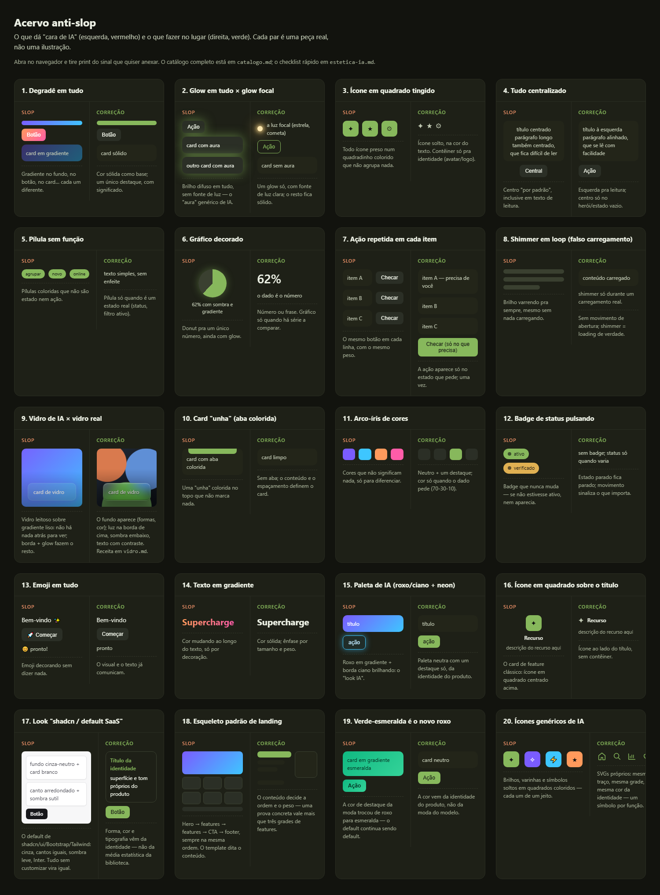

# deslop — take the "AI slop" out of an interface

A skill (Claude Code, Codex, OpenCode) that **de-slops an existing screen**, or **builds a new one without the AI-generated look**.

"AI slop" is a screen that looks assembled by someone who doesn't use the product: every block with the same visual weight, text explaining what a drawing would show, repeated actions, gradients/glass/glow used as decoration. The goal is for **every element to exist for a reason the user can feel**.

---

## Before and after

The full gallery — every pattern the system flags, side by side with the fix (slop on the left in red, correction on the right in green):



One image per rule is also in [`docs/pares/`](docs/pares/), and the whole gallery is rendered in [`anti-slop/galeria.html`](anti-slop/galeria.html) (open it in a browser).

---

## What it does

- **De-slop** a screen that already exists (app, Figma, or a prototype it just made).
- **Build from scratch** a new screen without inheriting the AI look.
- **Ask before deciding** — intent, screen role, visuals, priorities. That's the main differentiator.
- **Search references with a cheap subagent** — it browses curated sources, takes screenshots, and returns only the outline; the main agent decides and applies (anti-token protocol).
- **Propose thematic effects** tied to the product's universe (a stars app gets constellations, a music app gets a waveform).
- **Run layered checks**: signal audit, aesthetic checklist, redundancy test, "outside look", second pass.

## How it works (the loop)

1. Read the project's taste (`gosto.md`) and rules (`receitas.md`).
2. Spot the slop signals, pointing each one in place.
3. Ask, propose a **grayscale wireframe**, and only then implement.
4. Self-contained **HTML** prototype (base64 images, real states).
5. Double check + outside look + second pass, and report what it found.

## Structure

```
deslop/
├── SKILL.md                  # the core: the loop and the rules
├── estetica-ia.md            # quick checklist (12 signals, with CSS and "when it's legitimate")
├── tipografia.md             # fonts without the AI look (indie, no serif, neutrals that pass)
├── vidro.md                  # real glassmorphism × AI glass (with CSS recipes)
├── componentes.md            # anatomy of table, metric, chart, chat, form
├── fontes-de-referencia.md   # curated sources (Mobbin, 60fps, Land-book, Godly, …)
├── gosto.md                  # template: the project's choices and rejections
├── receitas.md               # template: palette, surfaces and components
├── anti-slop/
│   ├── catalogo.md           # 80+ patterns in categories (with sources)
│   ├── galeria.html          # 20 slop × correction pairs, rendered
│   └── referencias/          # real slop examples ("AI SaaS" templates)
├── inspiracao/               # curated good references, by theme (landing, motion, dark…)
└── docs/                     # images: full gallery and one image per rule
```

## Anti-slop collection

- **`catalogo.md`** — 80+ "AI slop" patterns and quality issues, in 10 categories (typography, color, layout, motion, copy…), each with what gives it away and the fix.
- **`estetica-ia.md`** — the 12-signal checklist to run on every screen.
- **`galeria.html`** — the visual version: each signal as a **slop × correction** pair, side by side.

## Install

### Claude Code

Copy the skill folder into the project:

```bash
cp -r skills/deslop my-app/.claude/skills/deslop
```

Then fill in `gosto.md` and `receitas.md` in the project's folder (they are templates). Everything else lives in the skill.

### Codex / OpenCode

Same idea: place the folder in `skills/deslop` (or the agent's skills directory) and point `gosto.md`/`receitas.md` to the project.

## Why only `gosto.md` and `receitas.md` per project

The skill is **canonical and generic**. Each project keeps only what is its own — the taste (choices and rejections) and the rules (palette, surfaces, components). The anti-slop collection, the sources and the rules live here, to avoid duplication.

## Golden rule

Every reference becomes a **concept** (hierarchy, rhythm, metaphor) — never a **copy** (palette, font, literal layout). Good references come contaminated too: take the idea, drop the aesthetic.
