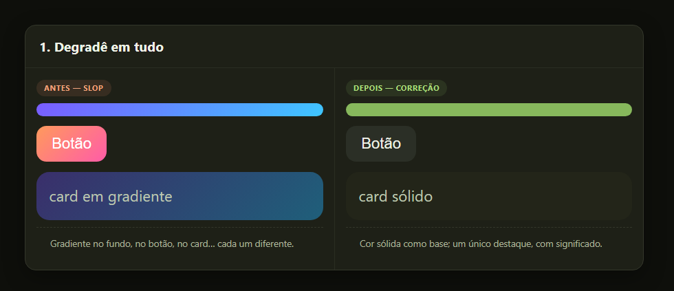
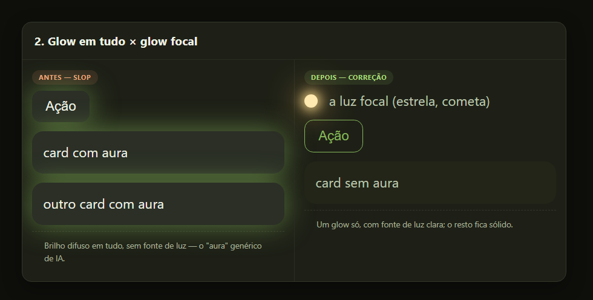
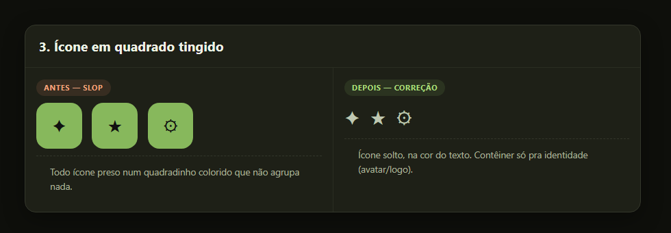
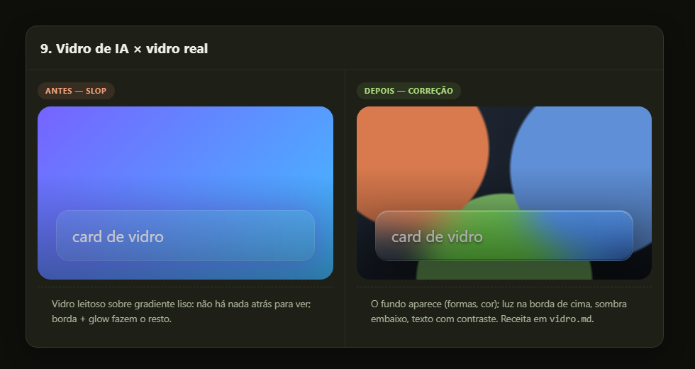
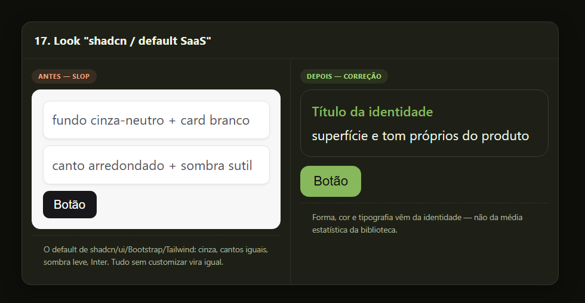
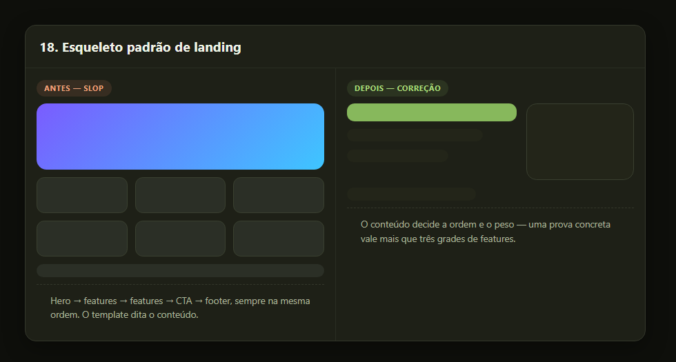
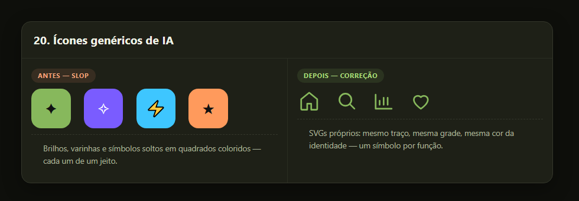

# deslop — tira o "AI slop" de uma interface

Uma skill (Claude Code, Codex, OpenCode) que **desalopa uma tela que já existe**, ou **cria uma tela nova sem cara de IA**.

"AI slop" é aquele visual que parece montado por quem não usa o produto: todos os blocos com o mesmo peso, texto explicando o que um desenho mostraria, ações repetidas, degradê/glass/glow por decoração. O objetivo desta skill é que **cada elemento exista por um motivo que o usuário perceba**.

---

## Antes e depois

A mesma peça, de dois jeitos — à esquerda o padrão que a IA reproduz por hábito ("AI slop"), à direita a correção. Algumas das regras do sistema:

**1. Degradê em tudo**



**2. Glow em tudo × glow focal**



**3. Ícone em quadrado tingido**



**9. Vidro de IA × vidro real**



**17. Look "shadcn / default SaaS"**



**18. Esqueleto padrão de landing**



**20. Ícones genéricos × SVGs próprios**



São 20 regras no total — uma imagem por regra em [`docs/pares/`](docs/pares/), e o acervo completo renderizado em [`anti-slop/galeria.html`](anti-slop/galeria.html) (abra no navegador).

## O que a skill faz

- **Desalopar** uma tela que existe (app, Figma ou um protótipo que ela mesma acabou de fazer).
- **Criar do zero** uma tela nova, sem herdar a cara de IA.
- **Perguntar antes de decidir** — intenção, papel da tela, visual, prioridades. É o principal diferencial.
- **Buscar referências com subagente barato** — navega nas fontes curadas, tira prints e devolve só o roteiro; a IA principal decide e aplica (protocolo anti-token).
- **Propor efeitos temáticos** ligados ao universo do produto (um app de estrelas ganha constelações, um de música ganha forma de onda).
- **Rodar checagens em camadas**: auditoria de sinais, checklist de estética, teste de redundância, "olhar de fora", segunda checagem.

## Como funciona (o ciclo)

1. Lê o gosto (`gosto.md`) e a régua (`receitas.md`) do projeto.
2. Identifica os sinais de slop, apontando cada um no lugar.
3. Pergunta, propõe um **wireframe cinza**, e só então implementa.
4. Protótipo em **HTML** autocontido (imagens em base64, estados reais).
5. Dupla checagem + olhar de fora + segunda checagem, e lista o que achou.

## Estrutura

```
deslop/
├── SKILL.md                  # o núcleo: o ciclo e as regras
├── estetica-ia.md            # checklist rápido (12 sinais, com CSS e "quando é legítimo")
├── tipografia.md             # fontes sem cara de IA (indie, sem serifa, neutras que passam)
├── vidro.md                  # glassmorphism real × vidro de IA (com receitas CSS)
├── componentes.md            # anatomia de tabela, métrica, gráfico, chat, formulário
├── fontes-de-referencia.md   # fontes curadas (Mobbin, 60fps, Land-book, Godly, …)
├── gosto.md                  # template: escolhas e recusas do projeto
├── receitas.md               # template: paleta, superfícies e componentes
├── anti-slop/
│   ├── catalogo.md           # 80+ padrões em categorias (com fontes)
│   ├── galeria.html          # 20 pares slop × correção, renderizados
│   └── referencias/          # exemplos reais de slop (templates "AI SaaS")
├── inspiracao/               # referências boas curadas, por tema (landing, motion, dark…)
└── docs/                     # imagens: showcase, galeria e pares individuais
```

## Acervo anti-slop

- **`catalogo.md`** — 80+ padrões de "AI slop" e problemas de qualidade, em 10 categorias (tipografia, cor, layout, movimento, copy…), cada um com o que denuncia e a correção.
- **`estetica-ia.md`** — o checklist de 12 sinais que se roda em toda tela.
- **`galeria.html`** — a versão visual: cada sinal em par **slop × correção**, lado a lado.

## Como instalar

### Claude Code

Copie a pasta da skill para o projeto:

```bash
cp -r skills/deslop meu-app/.claude/skills/deslop
```

Depois preencha `gosto.md` e `receitas.md` na pasta do projeto (são templates). O resto mora na skill.

### Codex / OpenCode

Mesma ideia: coloque a pasta em `skills/deslop` (ou no diretório de skills do agente) e aponte `gosto.md`/`receitas.md` para o projeto.

## Por que só `gosto.md` e `receitas.md` por projeto

A skill é **canônica e genérica**. Cada projeto mantém apenas o que é dele — o gosto (escolhas e recusas) e a régua (paleta, superfícies, componentes). O acervo anti-slop, as fontes e as regras moram aqui, para não duplicar.

## Regra de ouro

Toda referência vira **conceito** (hierarquia, ritmo, metáfora) — nunca **cópia** (paleta, fonte, layout literal). Referência boa também vem contaminada: aproveite a ideia, descarte a estética.
