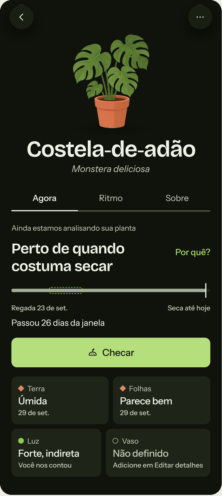
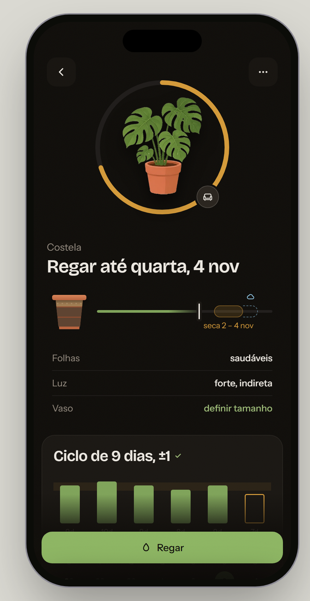

# Plant detail — Rootera (mobile app, plant watering)

**Mode:** Screen (redesign of an existing screen)

| Before | After |
|---|---|
|  |  |

## What was found

- **Text doing a drawing's job.** "Still analysing your plant", "Close to when it usually dries", "26 days past the window": three sentences to say one state.
- **Structured data as cards of text.** Four cards (Soil, Leaves, Light, Pot), each with a label, a value and a caption, all with the same weight.
- **Obvious origin of the data.** "You told us" under the light value.
- **Labels that repeat the content.** The "Now / Rhythm / About" tabs split one answer across three places.
- **Internal logic on display.** A "Why?" link next to the status, explaining the estimate instead of showing it.

## What changed and why

- **The state became the ring and one sentence.** The ring around the plant shows how far it is in the cycle, and the title says the only thing the person came for: "Water by Wednesday, Nov 4".
- **The drying window became a drawing.** The pot in cross-section and a timeline with the window ("dries Nov 2–4") replace the paragraph.
- **Details became three quiet rows.** Leaves, light and pot: a label and a value each, no captions and no card.
- **One action, fixed at thumb reach.** The state chooses it; there are no two equivalent buttons.
- **The history is a small chart**, because here there is a real series to compare (the length of each cycle).

## What stayed on purpose

- **The glow behind the ring.** The checklist flags glow, and a version without it was tested: left-aligned, with a plain list. The author rejected it ("it looks so dull"). The warm glow behind the object is already the language of the app's other cards, so it was recorded as an exception for this project.
- **The plant illustration.** Two other art styles were compared; the current SVG stayed.
