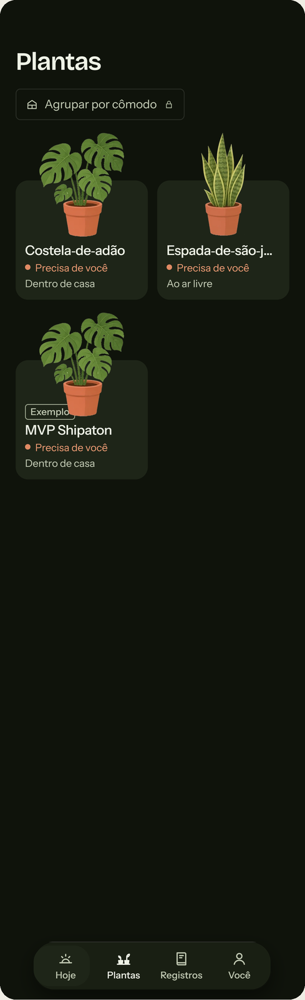
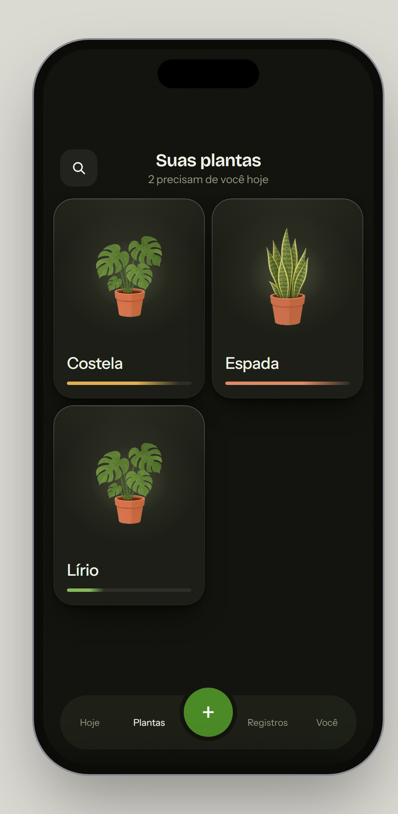

# Plants — Rootera (mobile app, plant watering)

**Mode:** Screen (redesign of an existing screen)

| Before | After |
|---|---|
|  |  |

## What was found

- **The same sentence on every item.** "Needs you" repeated under each plant, so it stopped meaning anything.
- **A control that controls nothing.** A locked "Group by room" pill at the top.
- **Truncated labels.** "Espada-de-são-j…".
- **Too much per card.** Name, status and place on each one. The author's words on an earlier attempt: "there is too much information at once".

## What changed and why

- **The count moved to the header.** "2 need you today" is said once, where it is the news.
- **Each card kept only what answers its question:** the plant, a short name, and one progress line whose length and colour show where it is in the cycle.
- **The switch on the card and the "add" card were removed.** The centre "+" in the tab bar already does that.
- **Search became a single icon** that opens a dropdown, instead of a permanent bar.

## What stayed on purpose

- **The soft halo behind each plant**, the same approved exception as on the plant detail screen.
- **The current SVG plants**, kept after comparing two other illustration styles.
