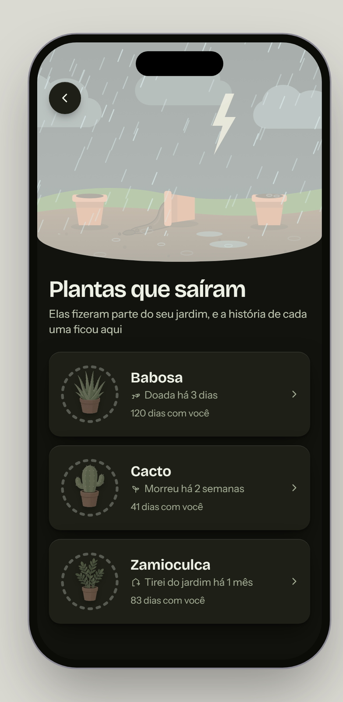

# Plants that left — Rootera (mobile app, plant watering)

**Mode:** Screen (a new screen, built from scratch)

A list of the plants that are no longer in the garden: donated, dead, or removed. There was no previous screen, so this case shows the decisions instead of a before.

## What the screen had to solve

Show that a plant is gone "without looking aggressive", keep its history, and let the person bring it back.

## How it got here

- **Not a grid.** A grid of cards like the Plants screen was rejected: it looked like the living garden.
- **Absence in the app's own language.** The first draft greyed out the whole card and showed the days in a warm clay colour. The outside reviewer, with no context, read the clay as an alert. It became the **empty ring**: the status ring that used to follow the plant, now dashed and colourless.
- **Empty space filled with pieces the app already has.** Lessons per plant, a bed with roots and "plant again" suggestions were rejected as "rather useless information". One large card per plant took their place, with the reason as an icon ("Donated 3 days ago") and "120 days with you".
- **A top that tells what happened.** A faded green header was rejected ("too faded, not much Rootera in it"). It became a garden in the rain with the pots that stayed: the one from the plant that died is tipped over. When a plant is brought back, the rain turns to sun and it sprouts in its pot.

## What this case shows

- The outside look changing a decision the author and the agent had both missed.
- A thematic effect that explains instead of decorating: the rain is the farewell, the sun is the return.
