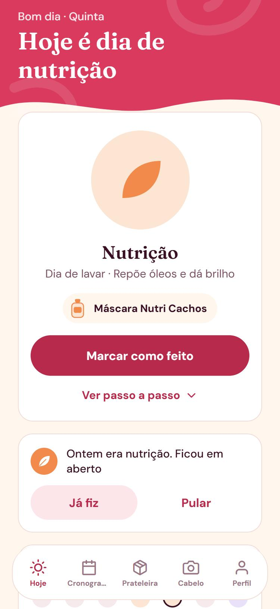
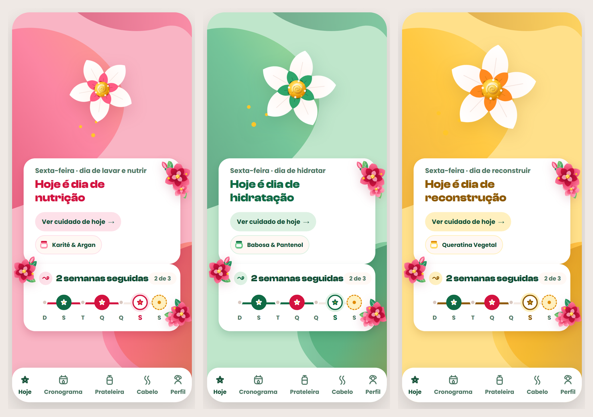

# Home — Cronohair (mobile app, hair-care schedule)

**Mode:** Screen (redesign, with a new identity from scratch)
**Role:** This screen exists to welcome the person and show, without demanding anything, how her hair's day is. It is not the screen for doing the treatment or marking it as done.

**Before:** the Today screen of the app, on a nutrition day.

**After:** the redesigned Home on the three treatment days: nutrition, hydration and reconstruction. Each day has its own colour, flower and product.

## What was found

- **The screen was the sum of its actions.** "Mark as done", "View step by step", "I did it", "Skip": four actions on a screen whose job is to receive the person.
- **A greeting with no data.** "Good morning · Thursday".
- **Stacked full-width cards with the same weight.**
- **Generic icons.** A sun, a box and a camera for a hair-care product, and a truncated tab label ("Cronogra…").
- **A week of dots** that did not tell done, today, planned and rest apart.
- **The same screen on every day.** Only the title and the icon in the circle changed between nutrition, hydration and reconstruction.

## What changed and why

- **The role sentence removed the main button.** The first wireframes were built around "Mark as done". After the sentence above was agreed, the screen was redrawn without it, and "Mark as done" moved to the treatment screen. Home reaches it through a text shortcut ("See today's care").
- **The greeting carries real data:** "Friday · wash and nourish day".
- **Each day is a different place.** The treatment sets the colour, the flower and the product chip, so the person knows the day without reading.
- **The week became a connected progress track**, with done, today, planned and rest drawn differently, and a "2 of 3" counter.
- **Icons from the product's universe:** a flower, a calendar with a drop, a mask jar, a curl.
- **Two cards joined with no gap**, so the day and the week read as one object.
- **The product chip wraps instead of overflowing.** At 375 px the longer names ("Hydrating gelatin, aloe and panthenol") pushed the chip past the card edge; it now drops to its own line.

## What was tested and rejected

- **Glass on the cards.** Three glass recipes were tried; solid white stayed.
- **A realistic generated curl** in the week card: "it doesn't look like an interface element".
- **Heavy grain texture**, and a sentence about tomorrow ("one piece of information too many").

## What stayed on purpose

- **The roses on the sides of the cards.** The outside reviewer read them as decoration. The author had asked for flowers overlapping the card edge and chose to keep them, so they were recorded as an exception.
