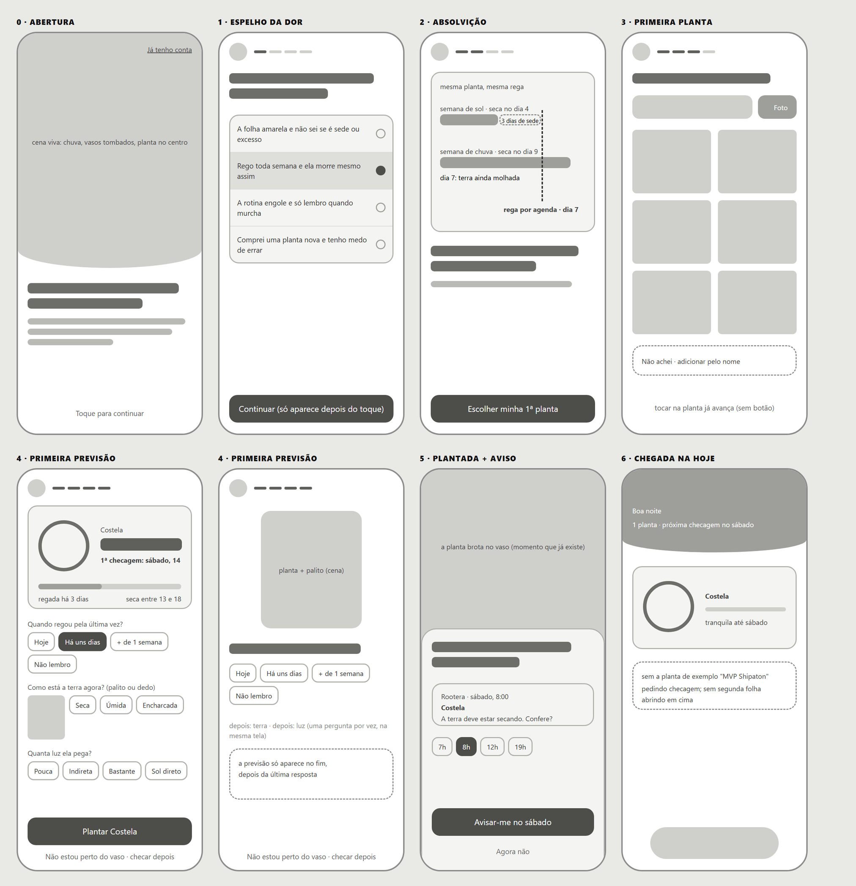

# Cases — wireframes, before and after

Real screens that went through the skill and were approved by the author. They show what the element gallery cannot: the judgement about structure, role and priority on a whole screen.

These live in `docs/`, outside the installed skill, on purpose. They are proof of what the skill does, not material for the agent to imitate: an agent that reads approved screens starts reproducing their look.

| Case | Product | Mode | Main change |
|---|---|---|---|
| [01 · Plant detail](01-rootera-plant/) | Rootera, plant watering app | Screen | Three tabs and four text cards became a ring, one sentence and one action |
| [02 · Plants](02-rootera-plants/) | Rootera | Screen | Each card kept only the plant, a short name and a progress line |
| [03 · Plants that left](03-rootera-plants-that-left/) | Rootera | Screen (new) | The outside look turned a grey card into the empty ring |
| [04 · Home](04-cronohair-home/) | Cronohair, hair-care schedule app | Screen | The role sentence removed the main button; each treatment day got its own colour and flower |

The interfaces are in Brazilian Portuguese, the language of both products.

## The wireframe comes first

Before any colour or font, the skill proposes gray skeletons and asks which organisation to follow. It is the cheapest moment to change your mind.

**Rootera, onboarding.** Eight screens decided in gray before spending time on colour, art and animation, including two options for the same step (the two "First forecast" screens). The labels are in Brazilian Portuguese, the language of the product.

## Format of a case

One folder per case, `NN-<name>/`, with:

- `before.png` and `after.png`: same viewport and, when possible, the same data and state. A screen built from scratch has no before; tell the decisions instead.
- `wireframes.png` when the case went through the wireframe step.
- `README.md` with: mode, the role sentence, what was found, what changed and why, what stayed on purpose, and what the outside look said.

## Choosing cases

- Three to five cases, from **different kinds of product**, so the set does not read as one house style.
- At least one where the fix was **structural** (what the screen is for), not only visual.
- Keep "What stayed on purpose": it shows the skill follows the user's taste instead of a fixed checklist.
- Only screens you own or have permission to publish.
